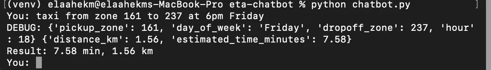

# ETA Chatbot

A local LLM chatbot that answers NYC taxi trip-time questions by calling my ETA API as a tool.

## How it works
- Model: `llama3.2:3b` running locally with Ollama
- The model decides when to call the `predict_eta` tool
- The tool sends a POST request to the API from [nyc-taxi-eta-api](https://github.com/elaahekm/nyc-taxi-eta-api)
- The exact numbers from the API are printed in the terminal



## Run
1. Start the ETA API: `uvicorn main:app --port 8000`
2. Install: `pip install ollama requests`
3. Run: `python chatbot.py`

## Example
```
You: taxi from zone 161 to 237 at 6pm Friday
Result: 7.58 min, 1.56 km
```

## Note
The 3B model sometimes writes numbers wrong in its own answer, so the program prints the API result directly.

## Structured output
`structured.py` uses Pydantic to force the model to return a validated trip object (zones, hour, day), which is then sent to the ETA API.

## Evaluation

`eval.py` runs 5 test questions and checks that the model extracts
(pickup_zone, dropoff_zone, hour, day_of_week) correctly.

Run: `python eval.py`

Score: 5/5 (with a system prompt; 2/5 without it)