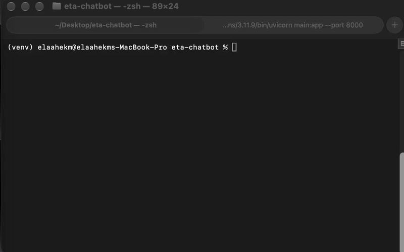

# ETA Chatbot

A local LLM chatbot that answers NYC taxi trip-time questions by calling my ETA API as a tool.

## How it works
- Model: `llama3.2:3b` running locally with Ollama
- The model decides when to call the `predict_eta` tool
- The tool sends a POST request to the API from [nyc-taxi-eta-api](https://github.com/elaahekm/nyc-taxi-eta-api)
- The exact numbers from the API are printed in the terminal


## Run
1. Start the ETA API: `uvicorn main:app --port 8000`
2. Install: `pip install -r requirements.txt`
3. Run: `python chatbot.py`

## Example
```
You: taxi from zone 161 to 237 at 6pm Friday
Result: 7.58 min, 1.56 km
```

## Note
The 3B model sometimes writes numbers wrong in its own answer, so the program prints the API result directly.

## Structured output
`structured.py` uses Pydantic to force the model to return a validated trip object (zones, hour, day), which is then sent to the ETA API.

## Evaluation

`eval.py` runs 5 test questions and checks that the model extracts
(pickup_zone, dropoff_zone, hour, day_of_week) correctly.

Run: `python eval.py`

Score: 5/5 (with a system prompt; 2/5 without it)

## Agent

`agent.py` is a LangChain agent (llama3.2:3b via Ollama) with one tool, `predict_eta`.
The model extracts the zones, hour and weekday name; Python converts the weekday
to a number and calls the ETA API. The final ETA is printed directly from the
API result, so the small model cannot change the numbers.

Run: start the ETA server first, then `python agent.py`


## LangGraph Agent

`graph_agent.py` is a multi-step agent built with LangGraph. It has three nodes connected in sequence:

1. **extract**: uses Ollama (llama3.2:3b) with a pydantic schema to pull pickup zone, dropoff zone, hour and weekday from the question
2. **predict**: calls the ETA API (`POST /predict_eta`)
3. **answer**: builds the final answer directly from the API result

Run it (the ETA server must be running on port 8000):

```bash
python graph_agent.py
```


### Limitations

- The extraction step uses a small 3B model, so it can misread unusual phrasing; the final answer is built directly from the API result, not by the model.
- Zones must be given as numeric IDs (1-265); place names like "Midtown" are not mapped yet.


## Multi-Tool Agent


The LangGraph agent now has two tools: ETA prediction and a weather tool (currently a stub that returns a fixed answer). A `decide` node checks the question and runs the weather node only when the user asks about the weather.